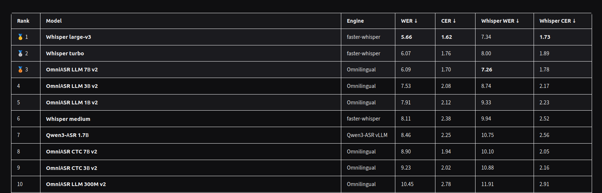

# Turkish ASR Model Evaluation

[](https://huggingface.co/spaces/EmreAkgul/Turkish-ASR-Leaderboard)

[Open the live Turkish ASR leaderboard](https://huggingface.co/spaces/EmreAkgul/Turkish-ASR-Leaderboard)

Evaluate ASR models with a common CLI:

```bash
./evaluate_model.py --engine <engine> --model <model> --dataset <dataset:split> [--device <device>] [--compute-type <type>] [--name <name>] [--workers <num_workers>]
```

Supported engines:

| Engine | Backend |
| --- | --- |
| `faster_whisper` | faster-whisper / CTranslate2 Whisper models |
| `omnilingual` | Meta Omnilingual ASR |
| `nemo` | NVIDIA NeMo ASR models |
| `nemotron_transcribe_vllm` | NVIDIA Nemotron 3.5 Transcribe via a `vllm serve` server |
| `mihu_stt` | `turkish-stt` (mihuai/turkish-stt) sherpa-onnx CPU streaming model |
| `balbal` | [balbal](https://github.com/erayyap/balbal) CPU models (balbal-v2, balbal-v2-manas) |
| `qwen3_asr_transformers` | Qwen3-ASR Transformers backend |
| `qwen3_asr_vllm` | Qwen3-ASR vLLM backend |

The `--dataset` value must be one of the supported dataset names plus a split:

```bash
./evaluate_model.py --engine faster_whisper --model small \
  --dataset fleurs:test
```

Supported datasets:

| Dataset | Hugging Face dataset | Config | Audio column | Reference column |
| --- | --- | --- | --- | --- |
| `fleurs` | `google/fleurs` | `tr_tr` | `audio` | `transcription` |
| `common_voice` | `fixie-ai/common_voice_17_0` | `tr` | `audio` | `sentence` |

Outputs are written to `results/<run_name>.jsonl`, and summary metrics are written to `results/<run_name>.summary.json`. Before scoring, non-spoken ASR control tokens such as `<tr-TR>` are removed and decomposed Turkish `i̇` is canonicalized. Primary scoring then applies NFC normalization, Turkish lowercasing, punctuation/symbol removal, and whitespace collapsing. Summary WER and CER are corpus-level error rates on a 0-100 percentage scale; the per-row JSONL rates are utterance-level diagnostics. Auxiliary `whisper_wer` and `whisper_cer` fields use Whisper's multilingual `BasicTextNormalizer` and do not replace the primary metrics.

Datasets are loaded in streaming mode so the CLI does not materialize the full dataset before evaluation.

### Number-normalized metrics (TN)

References and model outputs disagree on whether numbers are written as digits
or words (`yüzde 20'si` vs `yüzde yirmisi`), so the primary metrics penalize a
correct transcription for its formatting. The optional TN metrics convert
numbers to spoken Turkish on both sides before scoring. They use the Turkish
grammar of [NeMo text processing](https://github.com/Emre-Akgul/NeMo-text-processing/tree/tr-tn-cardinal):

```
clean artifacts -> Turkish lowercase -> Turkish TN grammar -> primary normalization
```

So `1.500` becomes `bin beş yüz`, `%25` becomes `yüzde yirmi beş`, `4'ü`
becomes `dördü` and `6.5` becomes `altı nokta beş`. Text is lowercased first
because the grammar spells out upper case acronyms (`ABD` -> `a be de`), and
FLEURS references are lower case while model outputs are cased.

Each row gets `tn_wer` and `tn_cer`, and the summary gets `mean_tn_wer`,
`mean_tn_cer` and `tn_grammar_hash`, which identifies the grammar version used.
The primary metrics are unchanged. A spelled-out number counts as several
words, so a model that drops a number loses more under TN than under the
primary metric.

Install the grammar into the environment that scores the results:

```bash
git clone -b tr-tn-cardinal https://github.com/Emre-Akgul/NeMo-text-processing.git
pip install -r NeMo-text-processing/requirements/requirements.txt
pip install --no-deps -e NeMo-text-processing
```

Compute TN metrics during an evaluation with `--tn`, or add them to existing
results without re-running any model:

```bash
./evaluate_model.py --engine faster_whisper --model small --dataset fleurs:test --tn
./scripts/recalculate_results.py --tn                    # every results/*.jsonl
./scripts/recalculate_results.py --tn results/mihu-stt-fleurs-test.jsonl
```

The first run compiles the grammar, which takes about a minute. It is cached
under `~/.cache/turkish_asr_eval/nemo_tn/<grammar hash>`, or under
`$TURKISH_ASR_EVAL_TN_CACHE`, and recompiled whenever the grammar changes.
Re-scoring files that already have TN metrics requires either `--tn` to
recompute them or `--drop-tn` to remove them, so a summary never mixes fresh
and stale TN numbers.

Common Voice example:

```bash
./evaluate_model.py --engine faster_whisper --model small \
  --dataset common_voice:validation
```

`faster_whisper` defaults to CPU int8:

```bash
./evaluate_model.py --engine faster_whisper --model small --dataset fleurs:test
```

Use CUDA explicitly:

```bash
./evaluate_model.py --engine faster_whisper --model small --dataset fleurs:test \
  --device cuda --compute-type float16
```

Nemotron 3.5 ASR Turkish example:

```bash
./evaluate_model.py --engine nemo \
  --model nvidia/nemotron-3.5-asr-streaming-0.6b \
  --dataset fleurs:test \
  --name nemotron-3.5-asr-streaming-0.6b-fleurs-test
```

Omnilingual ASR examples:

```bash
./evaluate_model.py --engine omnilingual \
  --model omniASR_CTC_300M_v2 \
  --dataset fleurs:test \
  --name omniASR_CTC_300M_v2-fleurs-test
```

```bash
./evaluate_model.py --engine omnilingual \
  --model omniASR_LLM_300M_v2 \
  --dataset fleurs:test \
  --name omniASR_LLM_300M_v2-fleurs-test
```

Qwen3-ASR examples:

```bash
./evaluate_model.py --engine qwen3_asr_transformers \
  --model Qwen/Qwen3-ASR-0.6B \
  --dataset fleurs:test \
  --device cuda
```

Use the vLLM backend with the same model IDs:

```bash
./evaluate_model.py --engine qwen3_asr_vllm \
  --model Qwen/Qwen3-ASR-0.6B \
  --dataset fleurs:test \
  --device cuda \
  --name Qwen3-ASR-0.6B-vllm-fleurs-test
```

```bash
./evaluate_model.py --engine qwen3_asr_transformers \
  --model Qwen/Qwen3-ASR-1.7B \
  --dataset fleurs:test \
  --device cuda
```

`turkish-stt` (mihuai/turkish-stt) example, CPU only:

```bash
./evaluate_model.py --engine mihu_stt \
  --model mihuai/turkish-stt \
  --dataset fleurs:test \
  --name mihu-stt-fleurs-test
```

Nemotron 3.5 Transcribe (30B-A4B) example. The model runs in a separate
vLLM server (see installation below), and the engine sends each sample to its
OpenAI-compatible endpoint (`http://127.0.0.1:8000/v1` by default, override
with `NEMOTRON_TRANSCRIBE_BASE_URL`). The engine sends the model card's
transcription request: prompt `Transcribe the following audio.`, temperature 0,
thinking off. The model detects the language itself, so no language is passed.

Baseline, without speculative decoding:

```bash
scripts/serve_nemotron_transcribe.sh --spec none   # terminal 1, vLLM env
./evaluate_model.py --engine nemotron_transcribe_vllm \
  --model nvidia/NVIDIA-Nemotron-3.5-Transcribe-30B-A4B \
  --dataset fleurs:test \
  --name NVIDIA-Nemotron-3.5-Transcribe-30B-A4B-vllm-fleurs-test
```

With the DFlash2 speculative-decoding draft model
(`nvidia/NVIDIA-Nemotron-3.5-Transcribe-30B-A4B-DFlash2`, BF16 main model only):

```bash
scripts/serve_nemotron_transcribe.sh --spec dflash2   # terminal 1, vLLM env
./evaluate_model.py --engine nemotron_transcribe_vllm \
  --model nvidia/NVIDIA-Nemotron-3.5-Transcribe-30B-A4B \
  --dataset fleurs:test \
  --name NVIDIA-Nemotron-3.5-Transcribe-30B-A4B-vllm-dflash2-fleurs-test
```

Speculative decoding is set on the server, so make sure the running server
matches the `--name` you choose. The engine checks the served model ID but
can't see the speculative config. With greedy decoding, DFlash2 should produce
the same output as the baseline up to small numerical differences, so the
comparison is mainly per-sample latency (`elapsed_seconds` in the JSONL). Keep
`--workers 1` for latency comparisons. `--spec mtp` uses the model's built-in
MTP heads instead (the card's quick-start default). The FP8 and NVFP4 variants
use the same commands with `--model nvidia/NVIDIA-Nemotron-3.5-Transcribe-30B-A4B-FP8`
or `...-NVFP4`. NVFP4 needs a Blackwell GPU.

[balbal](https://github.com/erayyap/balbal) examples, CPU only:

```bash
./evaluate_model.py --engine balbal \
  --model erayyapagci/balbal-v2 \
  --dataset fleurs:test \
  --name balbal-v2-fleurs-test
```

```bash
./evaluate_model.py --engine balbal \
  --model erayyapagci/balbal-v2-manas \
  --dataset fleurs:test \
  --name balbal-v2-manas-fleurs-test
```

balbal writes spoken numbers as digits (its default inverse text normalization)
and downloads the pinned model weights from Hugging Face on first use.

## Installation

Benchmark inference was run on RunPod using the
[RunPod PyTorch 2.8.0 template](https://console.runpod.io/hub/template/runpod-torch-v280).

Recommended reproducible install with `uv`:

```bash
uv sync --extra all --group dev
```

Install only one backend:

```bash
uv sync --extra faster-whisper --group dev
uv sync --extra omnilingual --group dev
uv sync --extra nemo --group dev
```

`turkish-stt` has no GPU or heavy ML dependencies, so it's simplest to install
in its own lightweight, CPU-only environment rather than pulling in the full
`all` extra:

```bash
python3.10 -m venv .venv-mihu-stt
.venv-mihu-stt/bin/pip install -e ".[dev]" turkish-stt==0.1.1
.venv-mihu-stt/bin/python ./evaluate_model.py --engine mihu_stt \
  --model mihuai/turkish-stt --dataset fleurs:test
```

`balbal` needs Python 3.11 or 3.12 and NumPy 2, so it gets its own CPU-only
environment. This repo declares Python 3.10, so install it without dependency
checks and add its runtime dependencies explicitly:

```bash
uv venv --python 3.12 .venv-balbal
uv pip install --python .venv-balbal/bin/python --no-deps -e .
uv pip install --python .venv-balbal/bin/python balbal==0.6.3 \
  "numpy>=2,<3" "pyarrow>=21" datasets==4.6.1 evaluate==0.4.1 jiwer==3.1.0 \
  soundfile==0.13.1 tqdm==4.67.1 whisper-normalizer==0.1.12 pytest==8.3.5
.venv-balbal/bin/python ./evaluate_model.py --engine balbal \
  --model erayyapagci/balbal-v2 --dataset fleurs:test
```

Qwen3-ASR currently needs its own environment because its dependency stack
conflicts with the pinned NeMo/Omnilingual environment:

```bash
python3.10 -m venv .venv-qwen3-asr
.venv-qwen3-asr/bin/pip install torch==2.8.0
.venv-qwen3-asr/bin/pip install -e ".[dev]" qwen-asr==0.0.6
.venv-qwen3-asr/bin/python ./evaluate_model.py --engine qwen3_asr_transformers \
  --model Qwen/Qwen3-ASR-0.6B --dataset fleurs:test --device cuda
```

For vLLM, use a separate environment and install Qwen's vLLM extra:

```bash
python3.10 -m venv .venv-qwen3-asr-vllm
.venv-qwen3-asr-vllm/bin/pip install -e ".[dev]" \
  "qwen-asr[vllm]==0.0.6"
.venv-qwen3-asr-vllm/bin/python ./evaluate_model.py \
  --engine qwen3_asr_vllm --model Qwen/Qwen3-ASR-0.6B \
  --dataset fleurs:test --device cuda
```

Nemotron 3.5 Transcribe needs vLLM 0.32.0 with the NeMo Speech plugin, on
Python 3.13, in its own environment (from the model card). The BF16 model was
tested on one H100 80 GB:

```bash
git clone https://github.com/NVIDIA-NeMo/Speech.git nemo-speech
cd nemo-speech
uv venv --python 3.13 .venv
UV_PROJECT_ENVIRONMENT=$PWD/.venv uv sync --extra asr --extra vllm --locked --no-install-project
uv pip install --python .venv/bin/python --no-deps -e .
uv pip install --python .venv/bin/python --no-deps av==19.0.2
uv pip install --python .venv/bin/python --no-deps opencv-python-headless==5.0.0.93
source .venv/bin/activate
cd -
scripts/serve_nemotron_transcribe.sh --spec none
```

The FP8 and NVFP4 variants also need `nvcc` from a CUDA 13 toolkit on `PATH`.
Before using `--spec dflash2`, apply the vLLM 0.32.0 patch to
`vllm/model_executor/models/qwen3_dflash2.py` from the
[DFlash2 model card](https://huggingface.co/nvidia/NVIDIA-Nemotron-3.5-Transcribe-30B-A4B-DFlash2).
Without it the server can fail when requests finish. The evaluation client
needs no extra packages, so run `evaluate_model.py` from the main environment.

Run commands inside the locked environment:

```bash
uv run pytest
uv run ./evaluate_model.py --engine faster_whisper --model small --dataset fleurs:test
uv run ./scripts/run_all_evaluations.py
```

## Reproduce Benchmark Runs

Set up the locked environment:

```bash
uv sync --extra all --group dev
```

Verify the code path:

```bash
uv run pytest
```

Preview the exact benchmark commands without running models:

```bash
uv run ./scripts/run_all_evaluations.py --dry-run --datasets fleurs:test
uv run ./scripts/run_all_evaluations.py --dry-run --datasets common_voice:test --limit 2000
```

Run the benchmark protocol:

```bash
uv run ./scripts/run_all_evaluations.py --datasets fleurs:test
uv run ./scripts/run_all_evaluations.py --datasets common_voice:test --limit 2000
```

This evaluates all configured models on the full Turkish FLEURS test split and
the first 2000 samples of the Turkish Common Voice test split. Outputs are
written to `results/<run_name>.jsonl` and
`results/<run_name>.summary.json`. Existing summary files are skipped unless
`--force` is passed.

Pip install is still supported. Base install:

```bash
pip install -e .
```

Install one backend:

```bash
pip install -e ".[faster-whisper]"
pip install -e ".[omnilingual]"
pip install -e ".[nemo]"
pip install -e ".[dev]"
```

Install `turkish-stt` (see the standalone-environment instructions above):

```bash
pip install -e ".[dev]" turkish-stt==0.1.1
```

Combined install:

```bash
pip install -e ".[all,dev]"
```

If editable install fails with an old `pip`, upgrade packaging tools once:

```bash
python3 -m pip install --user --upgrade pip setuptools wheel
```

The NeMo extra is pinned to a Git commit that supports
`nvidia/nemotron-3.5-asr-streaming-0.6b`.

The Omnilingual engine also accepts the official checkpoint URLs:

```bash
./evaluate_model.py --engine omnilingual \
  --model https://dl.fbaipublicfiles.com/mms/omniASR-CTC-300M-v2.pt \
  --dataset fleurs:test
```

Run the default full matrix sequentially:

```bash
uv run ./scripts/run_all_evaluations.py
```

The script evaluates every configured model on `fleurs:test` and
`common_voice:test`, skips jobs that already have a summary file, and continues
past individual failures. Preview commands without running models:

```bash
uv run ./scripts/run_all_evaluations.py --dry-run
```

## Development

```bash
uv sync --group dev
uv run pytest
```
